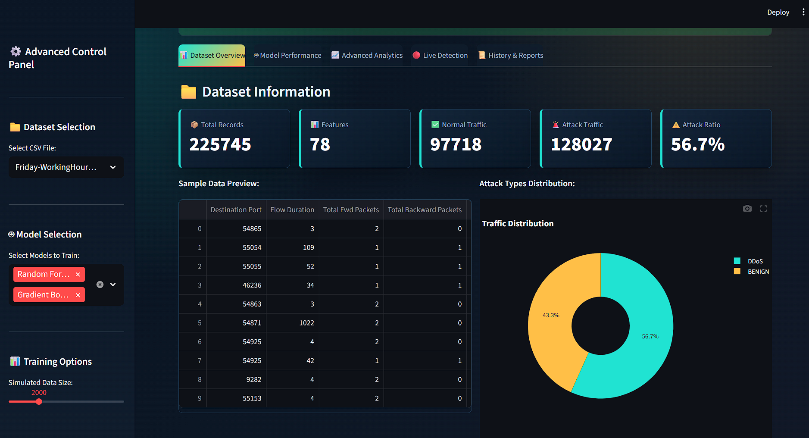
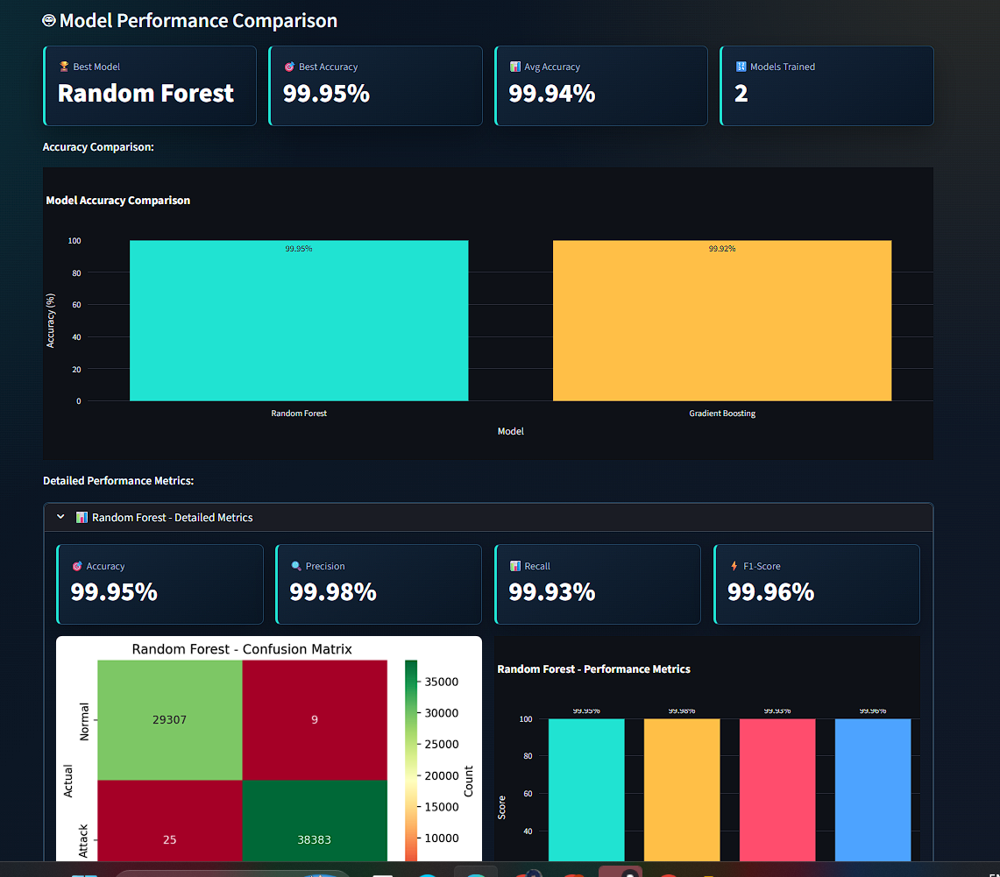
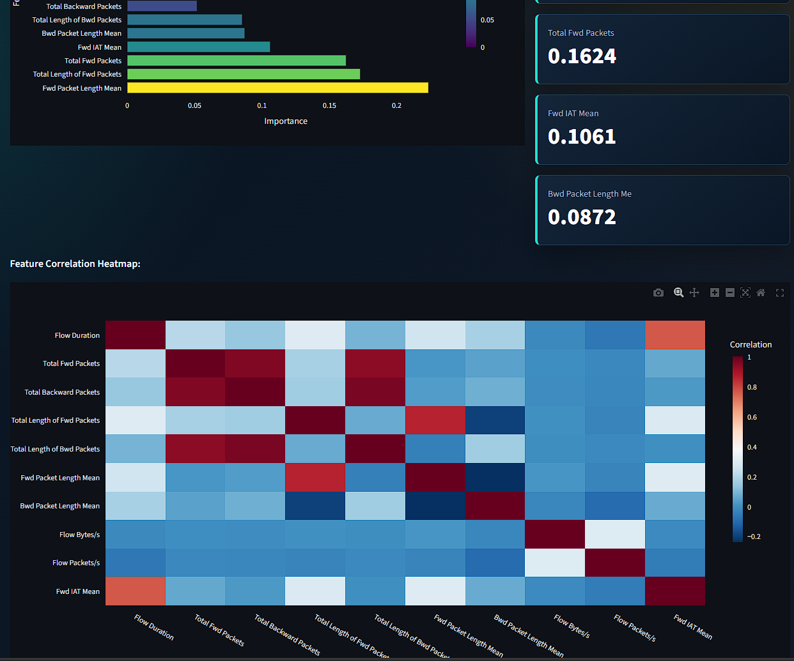

  <a href="README.md"><strong>OVERVIEW</strong></a> &nbsp; · &nbsp;
  <a href="DEMO.md"><strong>DEMO & SCREENSHOTS</strong></a> &nbsp; · &nbsp;
  <a href="DEMO.md#demo-setup"><strong>SETUP & DEPLOYMENT</strong></a>

# Demo Studio

**ML_project**

Walk through the experience. Explore the visuals. Prepare your demo.

---

## Visual preview

| Model performance | Analytics |
| :---: | :---: |
|  |  |

*Existing project screenshots; not a fresh runtime verification.*

---

## Five-minute walkthrough

1. Install `requirement.txt` and run `python -m streamlit run nids_app.py`.
2. Select `demo_synthetic.csv` in the sidebar.
3. Train Random Forest and Gradient Boosting.
4. Show Model Performance and Advanced Analytics.
5. Change feature sliders in Live Detection and select Analyze Traffic.
6. Export Results CSV. Explain that these artificial records demonstrate the UI, not detection accuracy.

## Deployment

Use `Dockerfile.demo`: build with `docker build -f Dockerfile.demo -t project-demo .` and run `docker run --rm -p 8501:8501 project-demo`. Configure a container host to route to port 8501. Data changes inside the container are ephemeral.

## Screenshots and verification

Existing project screenshots: [Dashboard](Screenshot/dashboard.png), [Analytics](Screenshot/Advanceanalytics.png).

Existing screenshots are historical assets, not fresh proof of this build. No new runtime screenshots or deployment success are claimed. Before sharing a demo, run the walkthrough, capture only fictional data, and record the commit SHA beside the images.
