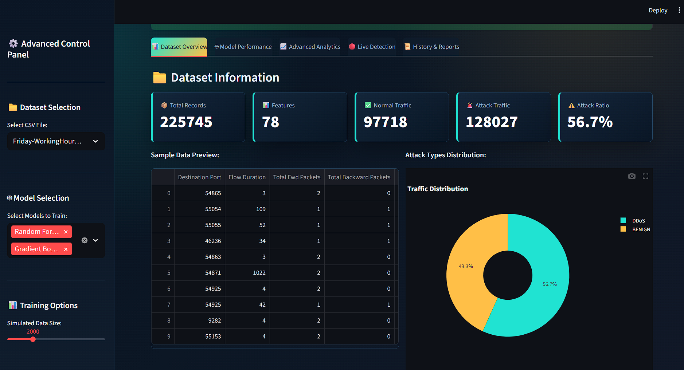

<p align="center">
  <a href="README.md"><strong>OVERVIEW</strong></a> &nbsp; · &nbsp;
  <a href="DEMO.md"><strong>DEMO & SCREENSHOTS</strong></a> &nbsp; · &nbsp;
  <a href="DEMO.md#demo-setup"><strong>SETUP & DEPLOYMENT</strong></a>
</p>

# NetGuard — Network Intrusion Detection

An academic machine-learning dashboard for exploring network-flow datasets, training classifiers, and comparing benign-versus-attack predictions.

**Python · Streamlit · scikit-learn · pandas · Plotly**

[Features](#features) · [Getting started](#getting-started) · [Methodology](#methodology) · [Screenshots](#screenshots) · [Limitations](#limitations)

## Features

| Workspace | Purpose |
| --- | --- |
| Dataset Overview | Inspect network-flow records and class distributions |
| Model Performance | Compare classifiers and evaluation metrics |
| Advanced Analytics | ROC/PR curves, feature importance, and correlation |
| Live Detection | Predict from manually entered feature values |
| History & Reports | Review session training history and export CSV data |

Models include Random Forest, Gradient Boosting, and an RBF-kernel SVM. Multi-model consensus compares predictions through majority voting.

## Getting started

Use a Python environment compatible with the pinned versions in [requirement.txt](requirement.txt).

```bash
git clone https://github.com/tejas764/ML_project.git
cd ML_project
python -m venv .venv
```

Activate the environment:

- **Windows PowerShell:** `.venv\\Scripts\\Activate.ps1`
- **macOS/Linux:** `source .venv/bin/activate`

Install and launch:

```bash
python -m pip install -r requirement.txt
python -m streamlit run nids_app.py
```

Open the local address printed by Streamlit. The actual filenames are `requirement.txt` and `nids_app.py`.

## Dataset and workflow

1. Put suitable CIC-IDS2017 network-flow CSV files in `Datasets/`.
2. Select a dataset in the sidebar. When CSV data is unavailable, the app offers simulated traffic for demonstrations.
3. Choose classifiers and train them.
4. Compare evaluation metrics, confusion matrices, and analytical charts.
5. Try a feature record in Live Detection and compare individual predictions with consensus.
6. Export the available CSV results.

Keep the dataset's source, license, and citation with your research records. Simulated traffic is not representative evidence of real-world detection performance.

## Methodology

- Replace infinite/missing numeric values during preprocessing.
- Map `BENIGN` to `0` and other labels to `1`.
- Select up to 15 network-flow features, with a numeric-column fallback.
- Use a stratified 70/30 train/test split with `random_state=42`.
- Train Random Forest (100 trees, maximum depth 15), Gradient Boosting (100 estimators), and SVM (RBF kernel with probability estimates), as selected.
- Compare accuracy, precision, recall, F1, ROC-AUC, and confusion matrices.

| Metric | Interpretation |
| --- | --- |
| Precision | Share of predicted attacks that are attacks |
| Recall | Share of actual attacks detected |
| F1 | Harmonic mean of precision and recall |
| ROC-AUC | Ranking performance across decision thresholds |
| False positive | Benign traffic classified as an attack |
| False negative | An attack classified as benign |

Feature correlation describes relationships between inputs. Random Forest importance describes how features contribute to that fitted model. Neither establishes causation.

## Project structure

| Path | Purpose |
| --- | --- |
| [nids_app.py](nids_app.py) | Streamlit interface, preprocessing, training, analytics, and prediction |
| [requirement.txt](requirement.txt) | Pinned Python dependencies |
| [Datasets/](Datasets/) | Input dataset files |
| [Screenshot/](Screenshot/) | Screenshots and versioned visual references |
| [SECURITY.md](SECURITY.md) | Security policy |

## Screenshots



[Model performance](Screenshot/modelperformance.png) · [Advanced analytics](Screenshot/Advanceanalytics.png) · [Interactive prediction](Screenshot/liveDetection.png) · [Consensus](Screenshot/consensus.png)

Screenshots are examples from recorded runs; metrics vary with data and configuration.

## Limitations

- Live Detection uses manual features; there is no integrated packet-capture or automatic flow-extraction pipeline.
- Predictions do not automatically block IPs, change firewall rules, or send external alerts.
- Current classification is binary, not attack-family identification.
- PCA, neural-network classification, and a separate scaling stage are not implemented in the documented training flow.
- Models are trained in the application session; a persistent production model-serving workflow is not included.
- High scores on one split or simulated data do not establish generalization. Independent datasets and false-positive analysis are needed.
- CSV export is available; the PDF report action is not an implemented report-generation workflow.

## Validation and next steps

Check both CSV and simulated-data paths, train each classifier, and compare the input schema used for predictions with training features. Useful future work includes cross-dataset evaluation, reproducible model artifacts, feature scaling experiments, and authorized packet-to-flow integration.

## Author and contribution

Maintained by [Tejas Bhandarkar](https://github.com/tejas764). Contributions should include the dataset context and verification steps. Use authorized datasets and follow [SECURITY.md](SECURITY.md).
